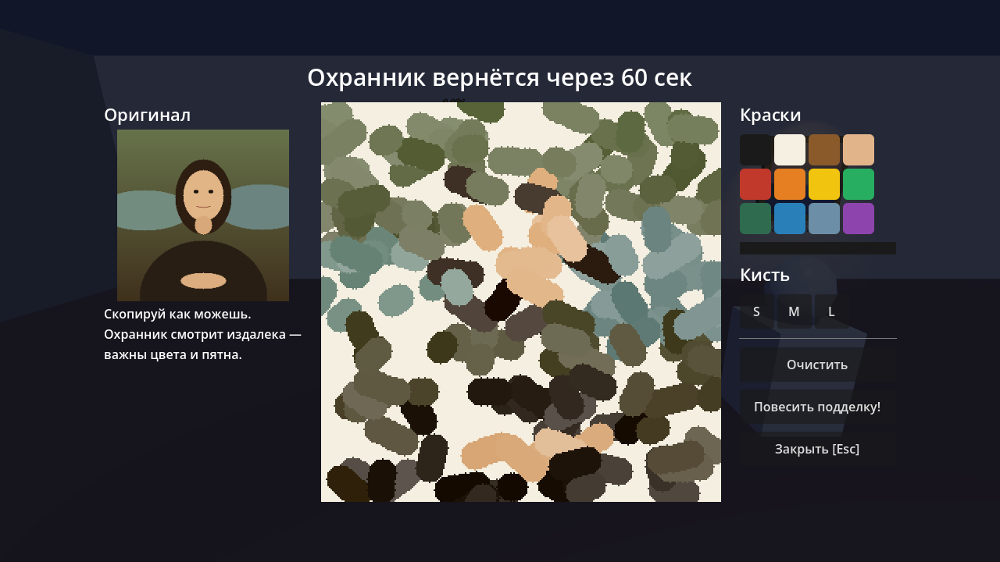

# ПОДДЕЛКА 🎨🕵️

Кооп-ограбление музея на 1–4 игроков: вы крадёте шедевры и вешаете вместо них подделки, которые рисуете прямо в игре, пока друзья отвлекают охрану.



## Что в этой папке

| Путь | Что это |
|---|---|
| `docs/01_GDD.md` | **Дизайн-документ:** вся игра — механики, уровни, прогрессия, монетизация |
| `docs/02_ASSETS.md` | **Покупать модели или делать самим:** стратегия по арту, источники, лицензии, бюджет |
| `docs/03_TECH.md` | Как устроен код и сеть, тесты, соглашения |
| `docs/04_ROADMAP.md` | План по этапам до релиза в Steam |
| `game/` | Проект Godot — играбельный прототип v0.1 |
| `CLAUDE.md` | Контекст для Claude Code: прочитает сам, когда ты запустишь его в этой папке |

**Что уже работает в прототипе:** меню, создать игру или подключиться по IP, тестовый зал музея, вор с камерой от третьего лица (видно других игроков и их ники), мольберт с общим холстом — мазки видны всем в реальном времени, оценка подделки, подмена картины с вердиктом охранника. Есть автотесты: одиночный и сетевой (хост + клиент) — оба проходят.

---

## Как начать на ноутбуке (пошагово, Windows)

### 1. Установи программы (всё бесплатно)

1. **Godot 4.7.x** — https://godotengine.org/download → *Godot Engine* (обычная версия, **не .NET**). Установка не нужна: распакуй zip, например в `C:\Godot\`, и запускай exe. Если на сайте уже вышла 4.8 — сначала работай на 4.7.x, обновимся вместе, когда понадобится.
2. **Git** — https://git-scm.com/download/win (при установке всё по умолчанию). Потом в терминале один раз:
   ```
   git lfs install
   git config --global user.name "Твоё имя"
   git config --global user.email "твоя@почта"
   ```
3. **Blender** (понадобится на этапе 2 для моделей) — https://www.blender.org/download/
4. **Claude Code** (чтобы работать со мной прямо в папке проекта) — инструкция: https://code.claude.com/docs. Коротко, в PowerShell:
   ```
   irm https://claude.ai/install.ps1 | iex
   ```

### 2. Забери проект себе

Проект сейчас лежит в репозитории `danil2579/dssssssss`, ветка `claude/focused-meitner-nrnpk8`, папка `poddelka/`. Лучше сразу вынести его в **отдельный приватный репозиторий**:

1. На GitHub: **New repository** → имя `poddelka` → **Private** → *без* README (пустой).
2. В терминале (PowerShell) на ноутбуке:
   ```powershell
   cd $HOME\Documents
   git clone -b claude/focused-meitner-nrnpk8 https://github.com/danil2579/dssssssss.git temp-dssssssss
   Copy-Item -Recurse temp-dssssssss\poddelka .\poddelka
   Remove-Item -Recurse -Force temp-dssssssss
   cd poddelka
   git init -b main
   git add .
   git commit -m "Старт проекта ПОДДЕЛКА"
   git remote add origin https://github.com/<твой-логин>/poddelka.git
   git push -u origin main
   ```

*Вариант попроще, без git:* открой ветку на GitHub → **Code → Download ZIP** → распакуй → возьми папку `poddelka`. Репозиторий всё равно стоит завести потом: без него легко потерять работу.

### 3. Открой проект в Godot

1. Запусти Godot → **Import** → выбери файл `poddelka\game\project.godot` → **Import & Edit**.
2. Первое открытие займёт несколько секунд (Godot создаст кэш в `game/.godot` — его в git не кладём, это уже настроено).
3. Нажми **F5** (Run Project) → меню → **«Создать игру»**. Управление: **WASD** — ходить, **мышь** — камера, **Shift** — бег, **Пробел** — прыжок, **E** — рисовать у мольберта, **Esc** — отпустить мышь или закрыть окно рисования.

### 4. Проверь мультиплеер на одном ноутбуке

1. В редакторе: **Debug → Customize Run Instances…** → включи **Enable Multiple Instances** → поставь **2** (или 3–4).
2. **F5** → откроется несколько окон. В первом «Создать игру», в остальных «Подключиться» (адрес `127.0.0.1`).
3. Подойди к мольберту, рисуй — во втором окне мазки появляются на мольберте в реальном времени. Нажми «Повесить подделку!» — у всех на стене появится твоё «творение» с оценкой.

**Поиграть с другом по сети прямо сейчас:** в одной Wi-Fi сети друг вводит твой локальный IP (`ipconfig` → IPv4). Через интернет понадобится проброс порта 7777 или Radmin VPN / ZeroTier. На этапе 2 это заменит Steam: там просто нажимаешь «Пригласить друга».

### 5. Запусти автотесты (по желанию)

Используй console-версию exe — она печатает вывод в терминал:
```powershell
cd $HOME\Documents\poddelka
C:\Godot\Godot_v4.7.2-stable_win64_console.exe --headless --path game res://tests/smoke_test.tscn
```
В конце должно быть `SMOKE TEST: OK`.

### 6. Работа со мной (Claude Code)

```powershell
cd $HOME\Documents\poddelka
claude
```
Я прочитаю `CLAUDE.md` и документы и буду в курсе проекта. Можно сразу сказать, например: *«Делаем этап 1: охранник с патрулём и шкалой подозрения»*.

Полезная привычка: после каждой рабочей сессии делать коммит и `git push`.

---

## Mac / Linux

Всё то же самое. Godot для macOS или Linux скачивается там же, команды в терминале аналогичные (`cp -r` вместо `Copy-Item`). Claude Code ставится командой `curl -fsSL https://claude.ai/install.sh | bash`.
